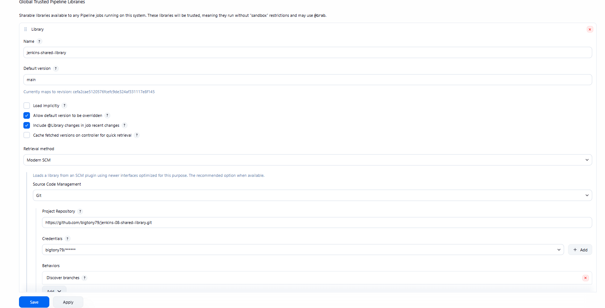
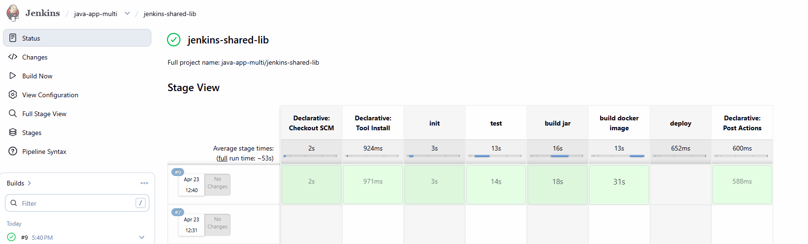

# Create a Jenkins Shared Library
This project provides a reusable Jenkins Shared Library designed to centralize and standardize pipeline logic across multiple Jenkins jobs and repositories. By moving common pipeline stages, functions, and utilities into a shared library, teams can simplify their Jenkinsfiles, reduce duplication, and ensure consistent CI/CD best practices across projects.

## Technologies used
Jenkins, Groovy, Docker, Git, Java, Maven

## Project Description: 
Create a Jenkins Shared Library (JSL) to extract common build logic: 
 -  Create separate Git repository for Jenkins Shared Library project
 -  Create functions in the JSL to use in the Jenkins pipeline
 -  Integrate and use the JSL in Jenkins Pipeline (globally and for a specific project in Jenkinsfile)

## Steps
### Step 1 - Create the Shared Library Repository
* Create a new private repository in GitHub for Jenkins Shared Library and assign a name such as "jenkins-shared-library".
* Create a Groovy project for the JSL using VSCode or IntelliJ and create a separate **vars** folder which will store the Groovy files for each function that we call from Jenkinsfile.
* Create the following buildJar.groovy and buildImage.groovy files and save them in the **vars** folder.
  
buildJar.groovy
```
    #!/usr/bin/env groovy
   
    def call() {
     echo " building the application for branch $GIT_BRANCH...."
     sh 'mvn package'
 }
```
buildImage.groovy
```
  #!/usr/bin/env groovy

  def call(String imageName) {
    echo "building the docker image..."
    withCredentials([usernamePassword(credentialsId: 'docker-hub-creds', usernameVariable: 'DOCKERHUB_USERNAME', passwordVariable: 'DOCKERHUB_PASSWORD')])
            {
                sh 'echo $DOCKERHUB_PASSWORD | docker login -u $DOCKERHUB_USERNAME --password-stdin'
                sh "docker build -t $imageName ."
                sh "docker push $imageName"
            }
 }
```
* Push the project to the newly created repository
```
 git init
 git add .
 git commit -m "Initial commit"
 git remote add origin https://github.com/bigtony79/jenkins-08-shared-library.git
 git push -u origin main
```


### Step 2 - Make the Shared Library globally available
* Go to 'Manage Jenkins' and click on System
* Scroll down to 'Global Trusted Pipeline Libraries' section and click Add
* Enter a name such as 'jenkins-shared-library'
* Enter 'main' for Default version
* Select 'Modern SCM' for Retrieval method and 'Git' for Source Code Management
* Enter the GitHub Repository endpoint (https://github.com/bigtony79/jenkins-08-shared-library.git) and select the appropriate credentials
* Click Apply and Save the configuration
  

### Step 3 - Use Shared Library in Jenkinsfile
In this step, we are going to make changes to the Jenkinsfile in our Java maven app (https://github.com/bigtony79/java-maven-app.git) to use the above two functions.
* Let's create a new branch from main branch of the Java maven app repository called 'jenkins-shared-lib' where we will test the functionality of Jenkins Shared Library
* Open the Jenkinsfile under the branch 'jenkins-shared-lib' and the following code on top of the file
```
  #!/user/bin/env groovy
  @Library('jenkins-shared-library')_
```
* Modify the Jenkinsfile by adding function calls to the Shared Libary Groovy scripts for the 'Build Jar' and 'Build Image' stages:
```
  stage('Build Jar') {
      steps {
        script {
          buildJar()
        }
      }
    }
    
    stage('Build Image') {
      steps {
        script {
          buildImage()
        }
      }
    }
``` 
* Push the changes to the remote repository
```
 git add Jenkinsfile
 git commit -m "Updated Jenkinsfile to use Jenkins Shared Library functions"
 git push origin jenkins-shared-lib
```
* Create a new Jenkins pipeline job and point it to the 'jenkins-shared-lib' branch of the Java maven app repository
* Run the pipeline and observe that the stages are executed successfully using the functions from the Jenkins Shared Library
  

### Conclusion
By creating a Jenkins Shared Library, we have centralized common pipeline logic, making it easier to maintain and reuse across multiple Jenkins jobs. This approach promotes consistency and reduces duplication in our CI/CD pipelines, ultimately improving efficiency and maintainability.


  


